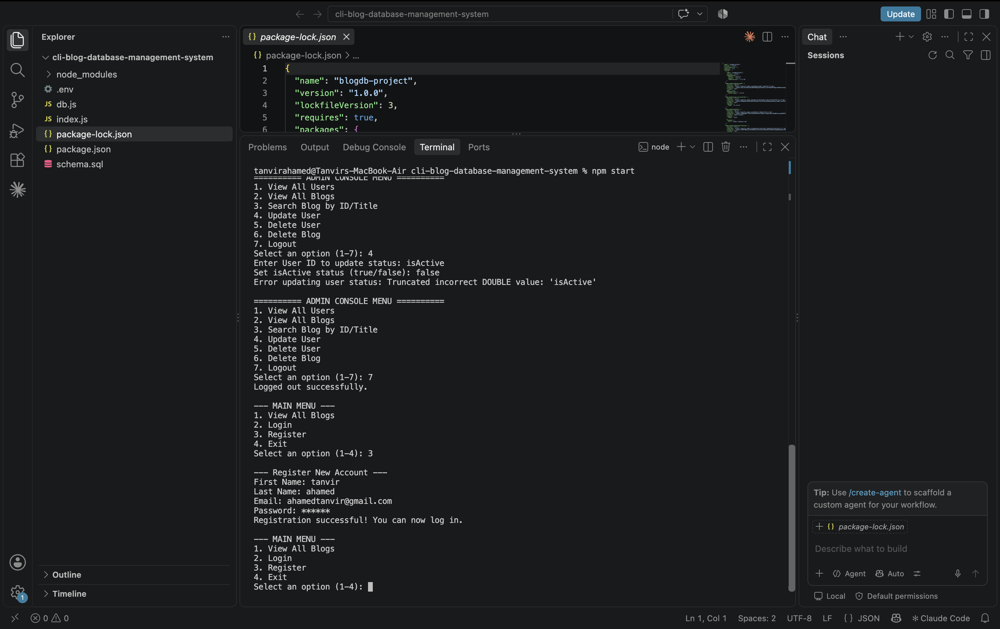

# Blog System Database Project

A command-line interface (CLI) Blog Management System built with **Node.js**, **JavaScript**, and **MySQL**. The application features role-based access control supporting Readers, Regular Users, and Admins, linked with a relational database architecture.

---

## 🛠️ Tech Stack

- **Runtime:** Node.js
- **Language:** JavaScript (ES6 Modules)
- **Database:** MySQL
- **Database Client:** `mysql2` (Promise-based)
- **CLI Framework:** `readline-sync`
- **Environment Management:** `dotenv`

---

## 🗄️ Database Architecture & Schema

The application uses a database named **`blogdb`** consisting of two main tables with a **one-to-many relationship** (One User $\rightarrow$ Many Blogs).

```
+-------------------+             +-------------------+
|       users       |             |       blogs       |
+-------------------+             +-------------------+
| id (PK)           | 1         * | id (PK)           |
| firstname         |<------------| userId (FK)       |
| lastname          |             | blogTitle         |
| email (UNIQUE)    |             | blog              |
| password          |             | category          |
| isActive          |             | createdAt         |
| role              |             | updatedAt         |
| createdAt         |             +-------------------+
| updatedAt         |
+-------------------+
```

### Table Properties

#### 1. `users` Table
- `id`: Primary key (Auto Increment)
- `firstname`: String (NOT NULL)
- `lastname`: String (NOT NULL)
- `email`: String (UNIQUE, NOT NULL)
- `password`: String (NOT NULL)
- `isActive`: Boolean (Default: `true`)
- `role`: String (Default: `'user'`; set to `'admin'` for administrative access)
- `createdAt`: Timestamp (Default: `CURRENT_TIMESTAMP`)
- `updatedAt`: Timestamp (Default: `CURRENT_TIMESTAMP ON UPDATE CURRENT_TIMESTAMP`)

#### 2. `blogs` Table
- `id`: Primary key (Auto Increment)
- `userId`: Foreign key referencing `users(id)` (ON DELETE CASCADE)
- `blogTitle`: String (NOT NULL)
- `blog`: Text (NOT NULL)
- `category`: String (NOT NULL)
- `createdAt`: Timestamp (Default: `CURRENT_TIMESTAMP`)
- `updatedAt`: Timestamp (Default: `CURRENT_TIMESTAMP ON UPDATE CURRENT_TIMESTAMP`)

---

## ✨ Application Features & User Journeys

### 📖 Reader Journey (Unauthenticated)
- Any visitor can view all published blogs without logging in via the main menu or by invoking `allBlog()`.

### 👤 User Journey
- **Registration & Login:** Secure account creation and login session.
- **View Your Blogs:** Displays blogs created by the logged-in user. Shows `"No blogs are found"` if the user has no posts.
- **Create Blog:** Allows users to write and publish new blogs.
- **Search Blog:** Search posts by **Blog ID** or **Blog Title**.
- **Update Blog:** Edit blog content/title using the corresponding **Blog ID**.
- **Delete Blog:** Remove owned blogs using the **Blog ID**.

### 🛡️ Admin Journey
- **View All Users (`allUsers()`):** Displays full account information of all registered users.
- **View All Blogs (`allUsersBlog()`):** Displays all blogs created across all users in the system.
- **Search Blog:** Search any blog in the platform by **Blog ID** or **Title**.
- **Update User Access:** Toggle `isActive` status of any user account. If set to `false`, login attempts for that user will be blocked with the message `"User is deactivated"`.
- **Delete User:** Remove any user account and cascadingly clean up their associated blogs.
- **Delete Any Blog:** Delete any post directly by ID regardless of author.

---

## 📂 Project Structure

```text
blog-system-database/
├── screenshots/          # Folder containing app screenshots
├── .env                  # Environment variables file
├── db.js                 # Database pool connection config
├── index.js              # Application entry point & CLI logic
├── package.json          # Project metadata & dependencies
├── schema.sql            # Database schema setup script
└── README.md             # Project documentation
```

---

## 🚀 Setup & Installation Instructions

### Prerequisites
- [Node.js](https://nodejs.org/) (v16.0.0 or higher)
- [MySQL Server](https://www.mysql.com/) installed and running locally

---

### Step 1: Clone or Open Project
Navigate to your project directory:
```bash
cd blog-system-database
```

---

### Step 2: Set Up Database Schema
Execute the SQL script in your MySQL shell to initialize `blogdb` and set up default administrative data:

```bash
mysql -u root -p < schema.sql
```

> **Default Admin Account Initialized:**
> - **Email:** `admin@blog.com`
> - **Password:** `adminpassword`

---

### Step 3: Configure Environment Variables
Create a `.env` file in the root directory and update your database credentials:

```env
DB_HOST=localhost
DB_USER=root
DB_PASSWORD=your_actual_mysql_password
DB_NAME=blogdb
```

---

### Step 4: Install Dependencies
Run npm to install all required packages:
```bash
npm install
```

---

### Step 5: Start the Application
Run the main script to launch the interactive console interface:
```bash
npm start
```

---

## 💻 Usage Instructions

### Main Menu Interface
Upon launching the application, you will see the primary options:
```text
========================================
   WELCOME TO THE BLOG DATABASE SYSTEM  
========================================

--- MAIN MENU ---
1. View All Blogs
2. Login
3. Register
4. Exit
```

### User Console Interface
After logging in with a regular user account:
```text
========== USER CONSOLE MENU ==========
1. View Your Blogs
2. Search Blog by ID/Title
3. Create Blog
4. Update Blog
5. Delete Blog
6. Logout
```

### Admin Console Interface
After logging in with an administrative account:
```text
========== ADMIN CONSOLE MENU ==========
1. View All Users
2. View All Blogs
3. Search Blog by ID/Title
4. Update User
5. Delete User
6. Delete Blog
7. Logout
```

---

## 🖼️ Application Screenshots

Place your UI capture images inside the `screenshots/` directory:




---

## Author

**MD. Tanvir Ahamed**